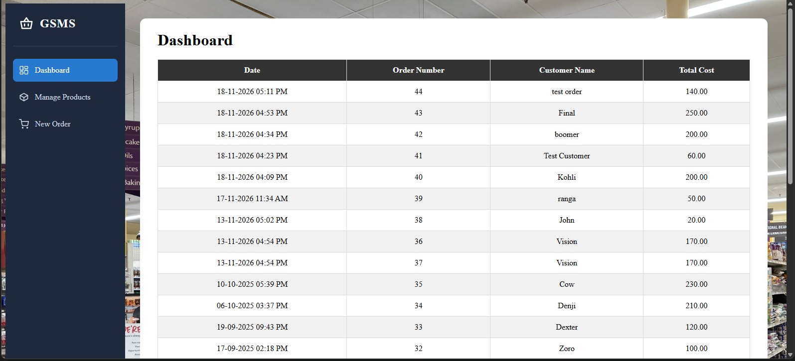
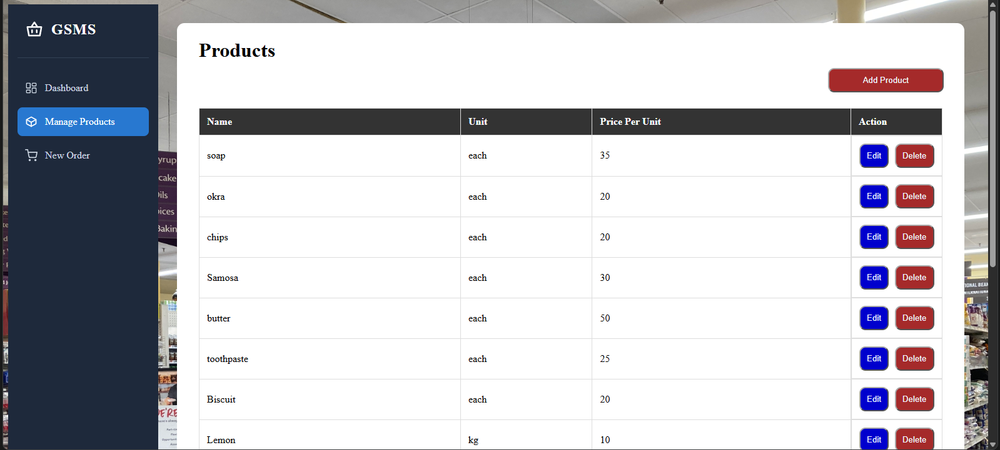
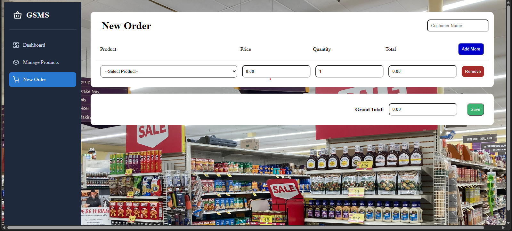

# Grocery Store Management System (GSMS)

A web-based Grocery Store Management System built using Python, Flask, MySQL, HTML, CSS, and JavaScript.

The application helps manage grocery products, create customer orders, calculate order totals, and view order history through a simple web interface.

## Features

## Screenshots

### Dashboard


### Manage Products


### New Order



### Product Management
- Add new products.
- View available products.
- Edit existing product details.
- Delete products that are not associated with existing orders.
- Manage product units and prices.

### Order Management
- Create customer orders.
- Add multiple products to an order.
- Specify product quantities.
- Automatically calculate item totals and the grand total.
- Validate order data on the backend.
- Store orders and their details in MySQL.

### Dashboard
- View previously created orders.
- Display customer names, order IDs, dates, and total amounts.
- View the latest orders first.

## Technologies Used

| Technology | Purpose |
|---|---|
| Python | Backend programming |
| Flask | Backend web framework |
| MySQL | Database |
| HTML | Page structure |
| CSS | Styling |
| JavaScript | Frontend functionality |
| Fetch API | Frontend-backend communication |

## Project Structure

```text
GSMS-v2/
│
├── backend/
│   └── app.py
│
├── css/
│   └── style.css
│
├── js/
│   ├── dashboard.js
│   ├── javascript.js
│   └── order.js
│
├── index.html
├── manage-product.html
├── order.html
├── .env
├── .gitignore
└── requirements.txt
```

## Installation and Setup

### 1. Clone the repository

```bash
git clone YOUR_GITHUB_REPOSITORY_URL
cd GSMS-v2
```

### 2. Create a virtual environment

```bash
python -m venv .venv
```

Activate it:

**Windows:**
```bash
.venv\Scripts\activate
```

### 3. Install dependencies

```bash
pip install -r requirements.txt
```

### 4. Set up the database

Open MySQL Workbench and execute the SQL script provided in `database.sql`.

This creates the `gs` database, all four required tables, and the default units of measurement.

### 5. Configure environment variables

Create a `.env` file in the project root:

```env
DB_HOST=localhost
DB_USER=gsms_app
DB_PASSWORD=YOUR_MYSQL_PASSWORD
DB_NAME=gs
```

Replace the password with your own MySQL application-user password.

**Note:** Never upload your `.env` file or database credentials to GitHub.

### 6. Run the Flask backend

From the project root:

```bash
python backend/app.py
```

### 7. Open the frontend

Open `index.html` using a local development server such as VS Code Live Server.

## API Endpoints

| Method | Endpoint | Description |
|---|---|---|
| GET | `/api/products` | Retrieve products |
| POST | `/api/products` | Add a product |
| PUT | `/api/products/<product_id>` | Update a product |
| DELETE | `/api/products/<product_id>` | Delete a product |
| GET | `/api/orders` | Retrieve orders |
| POST | `/api/orders` | Create a new order |

## Database Design

The application uses four MySQL tables:

- `products` – Stores product information and prices.
- `uom` – Stores units of measurement.
- `orders` – Stores customer order information and grand totals.
- `order_details` – Stores individual products, quantities, and item totals associated with each order.

## Security and Validation

- Uses parameterized SQL queries.
- Validates incoming order data on the backend.
- Calculates product totals using prices retrieved from the database instead of trusting frontend-submitted totals.
- Uses environment variables to store database credentials.
- Uses `.gitignore` to exclude sensitive configuration and generated files.

## Future Improvements

- Improve error handling and user feedback.
- Add automated testing.
- Improve deployment and production configuration.

## Author

**Sakthyram N M**

GitHub: https://github.com/Sakthyram

---

*This project was developed as a hands-on learning project to practise Python backend development, Flask APIs, MySQL database operations, and frontend-backend integration.*